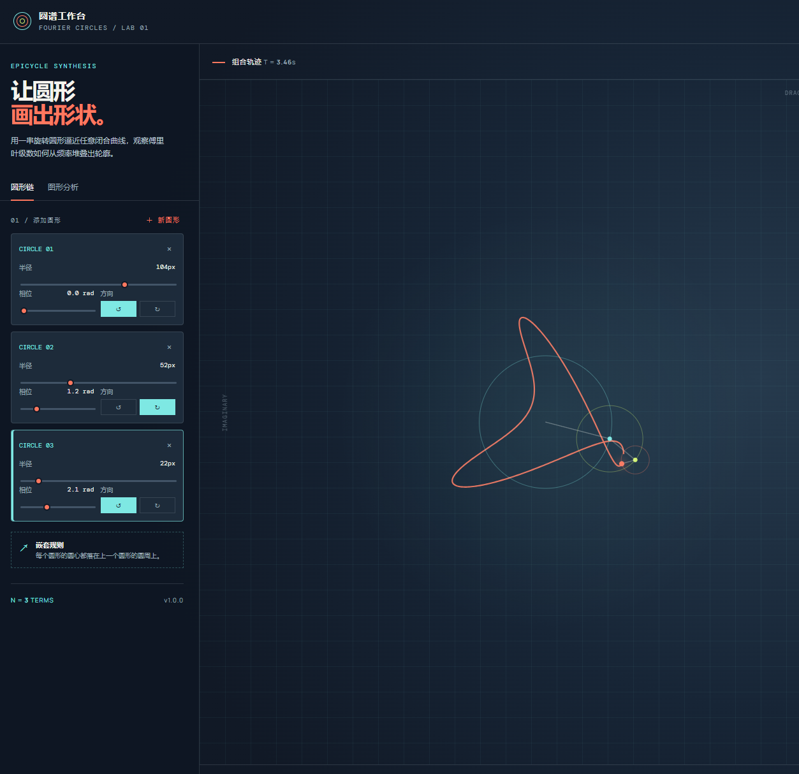
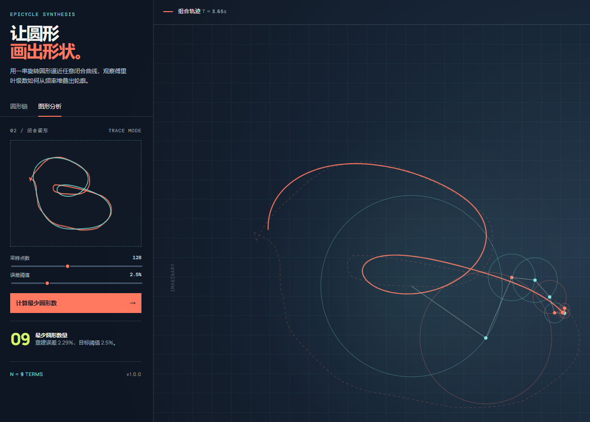

# 傅里叶变化试验台 / Fourier Transform Lab

一个面向教学、可视化探索和创意编码的傅里叶圆形实验台。通过旋转圆形（epicycles）叠加出轨迹，并把手绘闭合图形转换为可观察、可调节的傅里叶级数近似。

An interactive Fourier epicycle workbench for teaching, visual exploration, and creative coding. Build trajectories from rotating circles, or turn a hand-drawn closed shape into a Fourier approximation you can inspect and animate.

## 在线运行 / Live Demo

本项目是一个无需构建工具的静态网页，下载后可直接打开 `index.html`，也可以使用任意静态服务器运行。

This project is a dependency-free static web page. Open `index.html` directly, or serve the folder with any static HTTP server.

## 功能介绍 / Features

### 圆形链模式 / Circle Chain Mode

- 添加任意数量的嵌套圆形。
- 调整每个圆形的半径、相位和旋转方向。
- 每个圆形的圆心自动连接到上一个圆形的圆周。
- 实时显示圆形边界、旋转半径、端点和组合轨迹。
- 支持暂停、继续、重置和轨迹开关。
- 右侧数据面板实时显示圆形数量、半径总和、方向和波形。

- Add as many nested circles as needed.
- Tune the radius, phase, and rotation direction of every circle.
- Each circle is anchored to the endpoint of the previous vector.
- See circle boundaries, rotating vectors, endpoints, and the composite path in real time.
- Pause, resume, reset, and toggle the trail.
- Monitor active vectors, total radius, direction, and a compact waveform readout.

### 图形分析模式 / Shape Analysis Mode

- 在小画布中直接描画一个闭合轮廓。
- 设置采样点数量和允许的重建误差。
- 使用离散傅里叶变换（DFT）计算复数频谱系数。
- 按系数幅值从大到小累加圆形，直到 RMS 重建误差达到阈值。
- 返回达到目标误差所需的最少圆形数量。
- 在小画布中对比原始轮廓和重建轮廓。
- 在中央主画布中播放傅里叶圆形链、参考轮廓和动态重建轨迹。

- Draw a closed outline directly in the trace canvas.
- Choose the sampling count and acceptable reconstruction error.
- Compute complex Fourier coefficients with a discrete Fourier transform (DFT).
- Add terms from largest magnitude to smallest until the normalized RMS error is within the target.
- Report the minimum number of circles needed for the selected tolerance.
- Compare the source outline with its reconstruction in the trace canvas.
- Animate the Fourier epicycle chain, reference outline, and reconstructed path in the main stage.

## 算法说明 / Algorithm

1. 对手绘点按路径长度进行均匀重采样。
2. 将二维点表示为复数 `z = x + iy`。
3. 使用离散傅里叶变换计算每个频率的复数系数。
4. 根据系数幅值排序，逐项加入旋转圆形。
5. 计算所有采样点的归一化 RMS 重建误差。
6. 第一个满足误差阈值的系数数量，就是界面显示的最少圆形数量。

1. Resample the drawn path uniformly by arc length.
2. Represent each point as a complex value, `z = x + iy`.
3. Compute complex Fourier coefficients with a DFT.
4. Sort terms by coefficient magnitude and add them as rotating circles.
5. Measure normalized RMS reconstruction error across all samples.
6. The first term count that satisfies the tolerance is reported as the minimum circle count.

## 快速开始 / Quick Start

```bash
python -m http.server 4180 --bind 127.0.0.1
```

然后访问 `http://127.0.0.1:4180/`。

Then open `http://127.0.0.1:4180/`.

## 项目结构 / Project Structure

```text
.
├── index.html              # 页面结构 / UI structure
├── style.css               # 视觉样式 / visual system
├── app.js                  # 交互、动画与 DFT / interaction, animation, DFT
├── assets/
│   ├── circle-chain.png    # 圆形链截图 / circle chain screenshot
│   └── shape-analysis.png  # 图形分析截图 / shape analysis screenshot
└── README.md
```

## 截图 / Screenshots

### 圆形链 / Circle Chain



### 图形分析 / Shape Analysis



## 技术栈 / Tech Stack

- HTML5 Canvas
- Vanilla JavaScript
- CSS Grid、CSS Custom Properties、Responsive CSS
- No build step and no runtime dependency

## 许可 / License

本项目用于学习、演示和实验。你可以自由修改和扩展。

This project is intended for learning, demonstrations, and experimentation. Feel free to modify and extend it.
